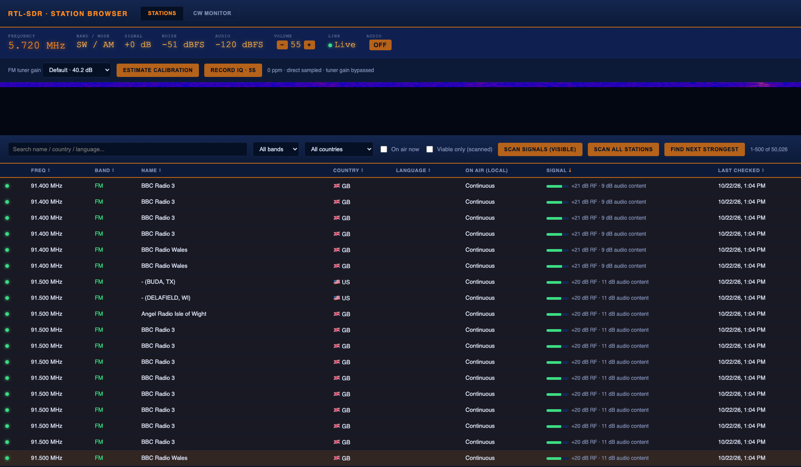
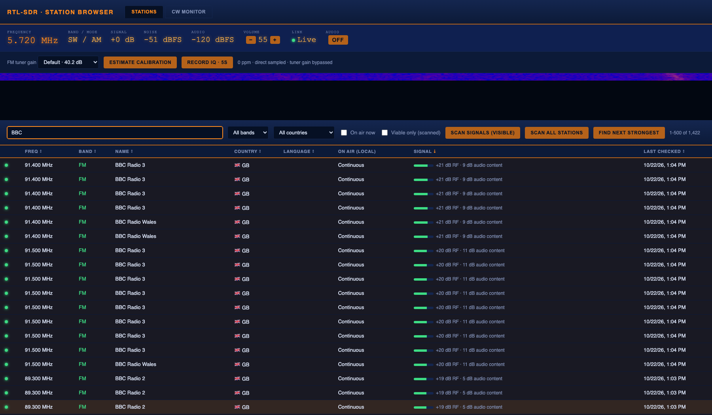
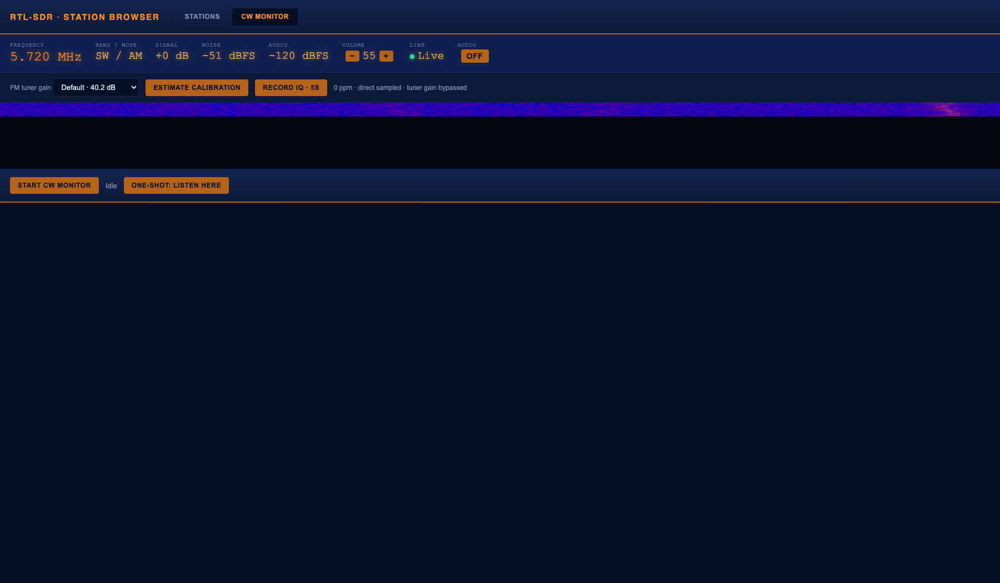

# RTL-SDR Station Browser

A web app that tunes an RTL-SDR USB dongle in software, with a searchable 50,000+ station database, live signal scanning, and an automatic Morse code (CW) decoder. Originally built around a physical [ATS Mini](https://esp32-si4732.github.io/ats-mini/) receiver controlled over USB serial; rewritten to demodulate AM/FM/CW itself from raw IQ samples, so any RTL2832U-based dongle works and no dedicated receiver hardware is needed.

Author: **James Sawyer / JSLabs** — [jamessawyer.co.uk](https://www.jamessawyer.co.uk/) | [labs.jamessawyer.co.uk](https://labs.jamessawyer.co.uk/)







## What it does

- **Station browser**: 50,000+ shortwave, AM, and FM stations from EiBi (global shortwave schedules), the FCC (US/Canada AM+FM), and Ofcom (UK AM+FM). Search, filter by band, and see which shortwave broadcasts are on air right now based on your local time.
- **Click to tune**: click any station in the browser and the SDR retunes instantly — a direct frequency set, not a multi-second band search.
- **Signal scanning**: compares each tuned channel with the nearby RF noise floor and flags only stations that stand clearly above it. Results persist across restarts.
- **CW (Morse code) monitor**: cycles known CW-heavy frequencies (propagation beacons, ham calling frequencies), locks onto whichever one has real keying, and decodes it live in the browser — timestamped, frequency-tagged, scrolling — until the signal stops or fades below detection.
- **Live audio**: streams the demodulated audio to your browser over WebSocket and plays it via the Web Audio API — no physical audio cable needed, and it works from any machine on the network, not just whatever's plugged into the radio.

## Hardware required

- Any RTL2832U-based RTL-SDR USB dongle.
- FM broadcast (88-108 MHz) is within the tuner IC's normal range on every RTL-SDR dongle. AM/mediumwave (530-1700 kHz) and shortwave (1.6-30 MHz) are both below the tuner's PLL floor (~24-28 MHz) and are received via the RTL2832U's direct-sampling mode instead — a standard chip capability, but whether a given dongle's PCB actually wires that input to a usable antenna path varies by board. **Verify AM/SW reception against a real antenna and a known signal before relying on it**; this can't be confirmed from software alone.
- An antenna suited to the band you're targeting: the dongle's stock antenna is usually adequate for local FM, but shortwave/AM reception benefits substantially from a longer wire antenna.

## Running it

The project ships a `Dockerfile` and `compose.yaml` — this is the intended way to run it, since it keeps the RTL-SDR driver stack (a blacklisted kernel DVB module, `librtlsdr`, udev permissions) isolated from the host's Python environment:

```bash
docker compose up -d --build
```

The container needs the RTL-SDR dongle passed through (`compose.yaml` already does this via `/dev/bus/usb`) and needs the **host's** kernel DVB drivers (`dvb_usb_rtl28xxu`, `rtl2832_sdr`, `rtl2832`) blacklisted first, since those claim the device before `librtlsdr` in the container ever gets a chance to. On Debian/Ubuntu:

```bash
sudo apt-get install -y rtl-sdr librtlsdr-dev
sudo tee /etc/modprobe.d/blacklist-rtlsdr.conf <<'EOF'
blacklist dvb_usb_rtl28xxu
blacklist rtl2832_sdr
blacklist rtl2832
blacklist rtl2830
blacklist r820t
EOF
sudo reboot
```

Then browse to `http://<host>:8731`.

The container runs as a non-root user with all Linux capabilities dropped, a
read-only root filesystem, and only `./data` writable. The API controls physical
radio state and has no application-level authentication, so expose port 8731 only
on a trusted LAN or behind an authenticated reverse proxy; do not publish it to
the internet.

### Running without Docker (local dev)

```bash
pip install -r requirements.txt
./start.sh
```

`start.sh` warns if no RTL-SDR dongle is detected, starts the backend, and opens `http://127.0.0.1:8731` in your browser. You'll still need the host-side kernel driver blacklist above, or the DVB module will grab the dongle before Python ever tries to open it.

## Rebuilding the station database

`data/stations.db` ships pre-built. To refresh it from source:

```bash
python3 stations_db.py --eibi data/eibi_sked.csv \
  --regulator ofcom_fm:FM:data/ofcom_fm.csv \
  --regulator ofcom_am:AM:data/ofcom_am.csv \
  --fcc-fm data/fcc_fm_raw.txt \
  --fcc-am data/fcc_am_raw.txt
```

Source files aren't included in this repo (the FCC dumps alone are ~23MB); download links are in `stations_db.py`'s docstrings and the EiBi/FCC/Ofcom sites directly.

## How the CW monitor works

Tuning is a direct frequency set with no band list to navigate, so retuning between candidate frequencies is effectively instant - unlike the ATS Mini's relative band-stepping this replaced, there's no visible multi-second hop through intermediate bands.

The radio bridge tunes `tone_hz` off the actual carrier, so a keyed CW signal beats against that offset and produces an audible tone in the demodulated audio exactly when the carrier is present. From there, decoding works by capturing that audio, finding the tone's frequency, isolating it with a bandpass filter, extracting the on/off keying envelope, and converting the timing into dots, dashes, and text. No PyPI package does audio-to-Morse decoding well, so this part (`cw_decoder.py`) is a small local implementation on top of numpy/scipy, validated against synthetic Morse test signals in `test_cw_decoder.py`.

## User guide

### Browsing and tuning

The Stations tab shows the full database, 500 rows per page. Click a column heading to sort the complete filtered result set; **Signal** starts strongest-first and **Last checked** shows when that frequency was measured. Type in the search box to filter by name, country, or language, or use the country and band dropdowns for exact filtering. Country flags are rendered locally as Unicode, with a neutral globe for EiBi's non-ISO codes. Click any row and the SDR retunes instantly.

The bundled list's measured coverage and known omissions are recorded in
[DATABASE_AUDIT.md](DATABASE_AUDIT.md).

The **On air now** checkbox filters shortwave listings to schedules that are currently active, converted from the database's UTC times into your browser's local time zone automatically. AM and FM entries are broadcast-license data with no schedule, so they're always treated as on air.

The meter bar at the top is always live: current frequency, band/mode, signal above the nearby noise floor, absolute noise floor, volume, and an audio toggle.

### Signal scanning

Click **Scan signals (visible)** to measure the filtered stations (capped at 200 per request). The scanner compares in-channel spectral power with nearby spectrum captured at the same instant, rejects the dongle's centre-frequency DC spike, and smooths twelve sample windows. A station is marked clear at 6 dB above noise; the **Audible only** checkbox hides weaker results. Measurements persist across restarts.

### CW Monitor

The CW Monitor tab runs a background scan → lock → decode → release loop: it cycles a small set of known CW-heavy frequencies (propagation beacons with high duty cycles, ham calling frequencies), and the moment it detects real on/off keying it locks onto that frequency and decodes continuously, streaming the text live. When the signal goes quiet or fades below detection, that decode is pushed to the scrolling log with a timestamp, frequency, and WPM estimate, and scanning resumes.

**One-shot: listen here** does a single ~4 second capture-and-decode on whatever frequency the radio is currently tuned to, without touching the tuning — useful to check a specific frequency you've navigated to manually from the Stations tab.

A manual tune from the Stations tab always interrupts a running scan or CW hunt — background automation never fights you for control of the radio.

### Live audio

The **Audio** toggle in the meter bar opens a WebSocket to the server and streams the currently-demodulated audio to your browser, playing it via the Web Audio API. Because this is a network stream rather than a local hardware passthrough, it works from any device on the network, doesn't need exclusive access to anything, and can run alongside the CW monitor without contention - both just read the same underlying demodulated stream.

## Known limitations

- AM/shortwave reception depends on the RTL-SDR dongle's direct-sampling input actually being wired to a usable antenna path - this varies by board and hasn't been verified against a real signal on the deployed hardware. FM broadcast is unaffected (it's within the tuner IC's normal range on every RTL-SDR dongle).
- Signal and noise figures are software estimates, not calibrated receiver measurements. A local interferer inside the channel can still look like a station; listening remains the final check.
- CW decoding needs a genuinely strong, clean signal. A stock whip antenna indoors will often not be enough for weak DX or beacon traffic even when everything else is working correctly.
- Signal scanning and CW listening are one-user-at-a-time operations on the radio itself: a manual tune always interrupts a running scan or the CW monitor.

## Disclaimers

- Not affiliated with, endorsed by, or supported by the RTL-SDR project, Realtek, or (for the station database) EiBi, the FCC, or Ofcom.
- Provided as-is, no warranty — see [LICENSE](LICENSE).
- Receiving shortwave, amateur, and broadcast radio is legal in most jurisdictions for listening purposes, but rules vary by country. Check your local regulations, particularly around recording or publishing intercepted communications.
- The CW decoder is a best-effort tool, not a certified or professionally audited instrument. Don't rely on it for anything safety-critical.

## License

MIT — see [LICENSE](LICENSE).
